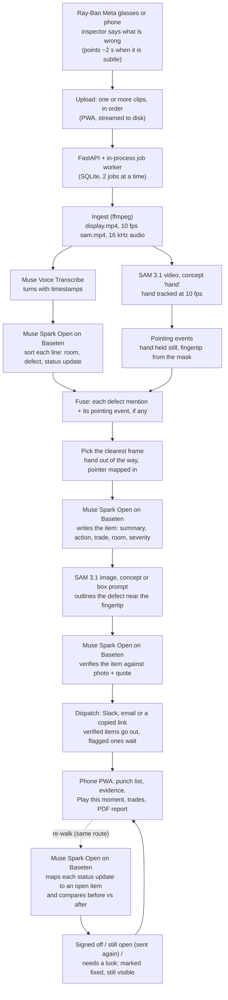

# Punchwalk

**Walk it once. Get a punch list with proof.** Punchwalk turns a construction punch walk into a verified,
dispatched punch list.

An inspector walks the unit wearing Ray-Ban Meta glasses (or holding a phone) and says what's wrong.
That's all an item needs. Pointing is optional: when a defect is subtle, or the exact spot matters, hold a
finger near it for about two seconds and Punchwalk uses the fingertip to pin it down. Punchwalk turns that
one video into a punch list. Each item has a photo with the defect outlined (plus a dot where the finger
pointed, when it did), a plain summary, the action needed, the trade, the room and the severity. Every item is checked against its own photo and the
inspector's words, then sent to the trade that has to fix it. On the re-walk, Punchwalk signs off what's
fixed, with before and after photos, and flags anything "marked fixed, but the defect is still visible".

*The voice says what. SAM proves where. Spark Open writes it up and checks it.*

Built from scratch for the Meta Global AI Developer Hackathon, starting Tue Nov 3, 2026 at 3:06 PM ET (first commit) — see the commit history.

- **Live app:** https://punchwalk.fly.dev. On a phone it opens the demo project "Unit 2B final punch" (three real walks,
  14 items); on a desktop, the landing page with the live app in a phone frame and a QR code.
- **Demo video (3 min):** `<!-- VIDEO_URL -->` (coming soon)
- **Built for:** Meta Global AI Developer Hackathon, Startup track, Nov 3–4, 2026

| Punch list | Item detail | Play this moment | Walk detail | Re-walk summary | How it was processed |
|---|---|---|---|---|---|
|  |  |  |  |  |  |

<sub>iPhone 15 Pro (393 × 852), Playwright WebKit, captured from the live build serving the seeded demo project.
These are real: our own glasses footage, and the quotes, red defect outlines and blue "pointed here" dots
the pipeline produced. Also in the screens folder: the message preview for a trade
([09](docs/screens/09-trade-preview.png)), the desktop landing page ([08](docs/screens/08-landing-desktop.png)),
and the record checklist mid-run ([05](docs/screens/05-record-processing-mock.png)). That one is from
mock data, because no walk was processing when we captured. See [the screenshots README](docs/screens/README.md).</sub>

### What to look at in the demo project

- **#003** (stovetop): marked fixed on the re-walk, but the defect is still visible. It's held as "Needs a
  look" with before and after photos. **#012** (hallway pencil marks) is the second false claim.
- **#011** (hallway outlet): tap **Play this moment** to jump to the second it was called out.
- **Walks → First walk**: items slide in over the video as the inspector calls them out.
- **Walks → Re-walk**: "7 signed off. 2 still open. 3 need a look."
- **First walk → How this walk was processed**: every model call, by model, in order.

## Why

A final punch walk takes minutes. The write-up takes hours: photos sorted by hand, defects retyped from
notes, a spreadsheet per trade. The contractor's final payment waits on it. Project managers do this on
their phones, between sites. Punchwalk makes the walk itself the input, and every item carries its proof:
the exact second of video, the photo with the defect outlined, and the inspector's own words.

**Beyond punch lists.** The same loop works anywhere someone walks a space and says what's wrong:
construction site and safety walks, Airbnb and rental turnovers and cleaning checks, move-in and move-out
reports in property management, and facilities and QA walkthroughs. What changes is the vocabulary and
who fixes what. The voice, the visual proof, the write-up and the check stay the same.

## How it works



Every stage is idempotent, cached, timed and resumable, and every external call is logged as a
`ModelCall` row with latency and estimated cost. That log is what the "How this walk was processed"
screen shows.

### Each Meta model and exactly what it does

| Model | Where | What it does in Punchwalk |
|---|---|---|
| **Muse Voice Transcribe** (`muse-voice-transcribe-1.0`) | Meta Model API, `/v1/asr/transcribe` | Transcribes the walk's audio in `ENDPOINTING` mode: one turn per sentence, with start and end times. A built-in construction vocabulary ("strike plate", "escutcheon", "GWB", room names) plus the project's keywords bias recognition. The turn times pick the moment each item's photo comes from, match a sentence to a pointing event when there is one, and set where "Play this moment" starts. |
| **SAM 3.1**, video (`sam-3.1`) | Meta Model API, `/v1/responses`, streamed | Tracks the concept "hand" through the walk at 10 fps, one request per uploaded clip. When the inspector points, SAM 3.1 follows the hand: a hand that holds still during a defect mention becomes a pointing event, and the fingertip comes from the hand mask. The walk view draws the hand outline from these masks. Walks without pointing still work; their items come from the voice alone. |
| **SAM 3.1**, image | same endpoint, image input | Outlines the defect on the evidence frame. First it tries a concept prompt with the noun phrase Spark Open chose (e.g. "door strike plate"), keeping the instance nearest the fingertip (or, when nobody pointed, nearest Spark Open's estimate of where the defect is). If that fails, it tries a box prompt from Spark Open's estimate. If both fail, the item keeps the photo with only the "pointed here" dot, or no mark if nobody pointed. |
| **Muse Spark Open** on Baseten (`meta-models/muse-spark-open-1026`) | Baseten, OpenAI-compatible chat completions, strict `json_schema` | All the reasoning. It sorts each transcript line (room, defect, status update) and writes each item from the evidence frame plus the quote (title, summary, action, trade, room, severity, what SAM should outline; `reasoning_effort=low`). It verifies each item against its rendered evidence and the original quote (`medium`). On a re-walk, it maps each status update to an open item and compares the before and after crops. |
| **Muse Spark 1.3** (`muse-spark-1.3`) | Meta Model API | **Fallback only.** It is used if Baseten fails twice (5xx or timeout) on a call. Every fallback is logged with `provider = "meta-fallback"` and shown in the UI. |

### Open weights

Every LLM call in the product path goes to **Muse Spark Open, Meta's open-weights model, served by
Baseten**, under the hackathon slug `meta-models/muse-spark-open-1026`. To be precise about what happened
on Nov 3: that slug returned `HTTP 404 {"error":"please check the model you provided"}`, while the catalog
slug `meta-models/muse-spark-open` answered. The client tries `-1026` first, falls back to the catalog slug
on a 404, remembers which slug answered, and records it on every call (`fixtures/probe/README.md`). Both
slugs are the same open-weights model on Baseten. The hosted Muse Spark 1.3 is reached only through the
logged fallback above, and `REASONING_PROVIDER=meta` is the explicit switch to use it instead. In the
seeded demo, all 62 reasoning calls went to Muse Spark Open on Baseten, and none fell back. The only Muse
Spark 1.3 call in the whole build was one probe call that tested the fallback's schema.

### Say it; point when it's subtle

The inspector doesn't stage anything, and doesn't have to point. Saying what's wrong while looking at it
is enough: Punchwalk picks a clear frame from that moment, Spark Open names what to outline, and SAM 3.1
outlines it. Pointing is for subtle defects (a hairline crack, a small nick) or when the exact spot matters.
Hold an index finger close to the defect for about two seconds. SAM 3.1 follows the hand, and the
fingertip pins the location and guides the outline.

## Evaluation

The inspector labels the staged defects for each walk (`eval/labels/*.csv`). `make eval` matches
predicted items to labels: within 6 s, and the same room or similar words, with a Hungarian assignment.
It writes `eval/report.md`, and it runs entirely from the cache. walk3 is a holdout in a different space
and is never used for tuning.

| Metric | Target | walk1 (first walk) | walk2 (re-walk) | walk3 (holdout) |
|---|---|---|---|---|
| Defects found (recall) | ≥ 0.90 | **1.00** (12/12) | n/a | **1.00** (2/2) |
| Precision | ≥ 0.90 | **1.00** (12/12) | n/a | **1.00** (2/2) |
| Right trade | ≥ 0.85 | **1.00** (12/12) | n/a | **1.00** (2/2) |
| Right room | ≥ 0.90 | **1.00** (12/12) | n/a | **1.00** (2/2) |
| Defect outlined (pointed items) | reported | 0.91 (10/11) | n/a | 0.50 (1/2) |
| Needs a look rate | reported | 0.25 (3/12) | n/a | 0.50 (1/2) |
| Closure accuracy (signed off vs. really fixed) | ≥ 0.90 | n/a | **0.92** (11/12) | n/a |
| False "fixed" claims caught | 100% | n/a | **100%** (2/2) | n/a |

Every target we set before tuning is met. The full per-item tables are in [eval/report.md](eval/report.md). Read
these numbers with their limits in mind:

- **It's a small test set.** walk1 has 12 labeled defects, walk2 has 12 re-walk statements (two of them
  false "fixed" claims), and walk3 has 2 defects. One miss would move walk1's recall by 8 points and
  walk3's by 50. Treat this as a careful smoke test, not a benchmark.
- **walk1 and walk2 were tuned on.** The prompt and threshold changes are in the git history (commit
  "phase 3.4: tuning on walk1+walk2"). walk3 was recorded in a laundry room and never used for tuning.
- **Our walks point at most defects** (11 of 12 on walk1), so the outline rate is reported for pointed
  items. Described-only items are scored the same way for found, trade and room.
- **The 3 "Needs a look" items on walk1** (#001, #005, #008) are photo-quality flags. Their best frames
  are overexposed or blurry, so the verifier said "The frame doesn't show the defect described." and held
  them for a person instead of sending them. That's the check doing its job: all three items are correct, and
  all three were signed off on the re-walk.
- **One pointed item has no outline on purpose.** #006 (cabinet knob) keeps only the "pointed here" dot
  after the last grounding fix: no outline beats a wrong outline.
- **The one closure miss is the safe kind.** #004 (light switch screw) really was fixed, but the re-walk
  photo didn't clearly show it, so it went to "Needs a look" instead of being signed off. Nothing was
  signed off that wasn't fixed.
- **Model answers vary from run to run.** These numbers replay the recorded answers of the final run
  (`make eval`, cache readonly, $0). A fresh live run can come out differently.

## Cost and time per walk

Prices are from `punchwalk/clients/cost.py`:
- SAM 3.1 video: $0.20 per 1,000 frames
- SAM 3.1 images: $2.50 per 1,000
- Muse Voice Transcribe: $0.18 per audio hour
- Muse Spark Open on Baseten: $1.25 / $4.25 per million input / output tokens
- Muse Spark 1.3 fallback: estimated at $3 / $15

Measured on our real glasses footage, from the cost ledger (`data/cost_ledger.jsonl`) for the recorded
runs. Spark Open is priced from the token counts Baseten returned.

| Walk | Length | Output | Live cost | Pipeline time |
|---|---|---|---|---|
| walk1, first walk | 105 s, 5 glasses clips | 12 items | **≈ $0.54**: ≈ $0.22 to hear and track (Muse Voice Transcribe + SAM 3.1 following the hand at 10 fps), ≈ $0.32 to write, outline and check the 12 items | ≈ 4.8 min on a laptop |
| walk2, re-walk | 81 s, 5 clips | 12 status updates checked against open items | **≈ $0.33** | not timed separately |
| walk3, holdout | 16 s, 1 clip | 2 items | **≈ $0.08** | not timed separately |

Rules of thumb from those runs:
- Following the hand costs about $0.20 per 100 s of walk (1,000 frames at 10 fps).
- Each item costs about $0.03 to write, outline and check.
- **Estimate** for the longest walk we accept (10 minutes, 20 defects): about $1.20 for tracking plus
  $0.60 for items, so roughly $1.80. We haven't measured this.

Live latencies from the probe: Files 2.3 s, SAM video 7.0 s for 90 frames, SAM image 1.4–2.9 s, ASR 3.6 s
for 5 s of audio, and Spark Open 4.2 s per call (`fixtures/probe/README.md`).

The whole build cost **≈ $3.06** of live Meta and Baseten calls, including probes, prompt tuning and
fixture recording, against a $25 cap. Replaying a walk from the cache costs $0. That's why the seeded
demo's "How this walk was processed" screen says "from recorded model answers (no new cost)".

## Run it

Requirements: Python 3.11 with [uv](https://docs.astral.sh/uv/), Node 22 with pnpm, and ffmpeg. The PDF
report also needs WeasyPrint's Pango libraries, which the Docker image includes.

```bash
make setup          # uv sync + pnpm install
cp .env.example .env  # then fill in MODEL_API_KEY and BASETEN_API_KEY (optional: SLACK_WEBHOOK_URL, RESEND_API_KEY + EMAIL_FROM)
make dev            # API + job worker on :8000 (serves the built PWA)
pnpm -C web dev     # the PWA with hot reload on :5173 (VITE_DATA=live to use the API)
make test           # offline: readonly cache + fixtures, no network
make eval           # eval/report.md from the cache
make seed           # the demo project from recorded walks, at $0 (see below)
make screenshots    # every DESIGN.md screen on the iPhone 15 Pro profile -> .verify/screens/
make docker         # one image: node build -> python 3.11 + ffmpeg + WeasyPrint
make deploy         # fly deploy (first-time setup: docs/DEPLOY.md)
```

**Demo data.** `make seed` creates the "Unit 2B final punch" project. It has a fictional trades
directory with `@example.com` contacts; Ace Electric has a Slack channel on an example domain that is
never contacted. The seed replays the recorded walks through the real pipeline from the cache, in
readonly mode, at $0. `--walks synth_walk` uses the synthetic walk in `fixtures/pipeline/`. The Linux
image's ffmpeg extracts frames with different bytes than the recording Mac, so on Fly the seed isn't
re-run. Export a snapshot where the walks were recorded (`scripts/seed.py --export`) and import it in
the container (`--import`). The commands are in [docs/DEPLOY.md](docs/DEPLOY.md).

**Layout.**
- `punchwalk/clients/`: the only code that calls the Meta Model API or Baseten, with the cache and cost ledger
- `punchwalk/pipeline/`: the stages
- `punchwalk/api/`: FastAPI and the job worker
- `punchwalk/dispatch/`: Slack, email, Copy link
- `punchwalk/report/`: the PDF
- `web/`: the React PWA
- `eval/`: labels and scoring
- `fixtures/`: recorded responses for offline tests

## Limitations

- **Pointing is optional, but when you do it, the hand has to be in view for about two seconds**, close
  to the defect without covering it. A hand that never holds still, or points off-frame, counts as not
  pointing: the item is still written from what was said, just without the pointed-here dot.
- **Described-only items depend on the camera.** Their photo comes from the moment the defect was
  described, so look at it while you say it. A subtle defect is easier to outline when you point.
- **One concept per SAM request.** The hand is tracked as "hand", and each defect outline is a separate
  image request, so a walk with many defects makes many small SAM calls.
- **No word timestamps.** Muse Voice Transcribe returns turn-level times, so a sentence covering two
  defects is split by meaning, not by the exact second each word was said.
- **Uploads are limited to 10 minutes and 400 MB per walk** (the transcription limit). Longer walks go up as
  separate walks.
- **The hackathon Baseten slug** (`-1026`) returned 404 during the build; the app falls back to the catalog
  slug of the same model and logs which one answered.
- **Replays are byte-exact.** Cached answers are keyed on the exact media, prompts and frames. A different
  ffmpeg build re-extracts frames differently, which is why the deployed demo imports a snapshot.
- One process, two walks at a time, SQLite on a single volume: right for a pilot, not yet for a fleet.

## Roadmap

- **Live, hands-free capture through Meta's Wearables Device Access Toolkit.** The glasses stream straight
  in, items are confirmed by voice as you walk, and a trade looks at a defect and hears its item.
- **Procore / Fieldwire sync**: push items, photos and status both ways.
- **Spec citations**: Muse Spark 1.3's 1M-token context reads the project specs and cites the section each
  item violates.
- **Live captions** on the walk video as it plays.

## Built during the hackathon

**Built during the Meta Global AI Developer Hackathon, Nov 3–4, 2026. Everything in this repo was created during the event.**

All footage and assets are our own: the walks were recorded by the team, and the fixtures and mock media
are synthetic. The build was planned and coordinated by an orchestrator agent (Claude Fable 5.1), and the
code was written by worker agents (Claude Opus 5.5), with every subphase independently verified before it
was committed. The dated list below comes from the git history.

**Nov 3, 2026**
- Scaffold, model clients for Files, Muse Voice Transcribe, SAM 3.1, and Muse Spark Open with its logged fallback. Includes a content-addressed cache and a cost ledger.
- `make probe`: one live call per API to confirm request and response shapes ($0.05). SAM mask coordinate check (masks are box-local).
- Contracts: database models, API schemas, a TypeScript mirror and mock API fixtures, all enforced by a contract test.
- Ingest: ordered clips → portrait-safe display video, 10 fps SAM video, 16 kHz audio, with HDR → SDR.
- Perception pipeline: transcription, turn classification, SAM 3.1 hand tracking for optional pointing (pointing events from the fingertip), fusion, evidence frames.
- Items: Spark Open writes each one, SAM 3.1 outlines the defect near the fingertip, Spark Open verifies it, and a resumable job runner ties the stages together.
- API: SQLite (WAL), range-capable media for iOS video seeking, upload with limits, progress (poll and SSE), the hand overlay, and guards.
- PWA: design system, punch list, item detail, Play this moment, walk detail with the hand overlay, the record flow with a live checklist, and "How this walk was processed".
- Dispatch to Slack, email or a copied link (Copy link: a shareable message, and the items count as sent), with an auto-send policy (verified items go out, flagged ones wait), and a PDF punch report.
- Docker image and Fly config, and `make seed` (zero-cost replay, plus a snapshot for the deployed image).
- Our own walks: three walks recorded on Ray-Ban Meta glasses (5 clips, 5 clips, 1 clip), with ground truth labeled by the inspector. `make record` captured every model answer ($0.44).
- Eval: label loading, matching (6 s window + Hungarian assignment), metrics and the report. Tuned on walk1 and walk2 until every target was met; walk3 held out.
- Re-walk loop: each status update is mapped to an open item and the before and after photos are compared. Items are signed off with proof, or flagged "marked fixed, but the defect is still visible". Still-open items are sent again, and the re-walk summary screen shows the result.
- Trades screen with the exact message preview, a public share page for each item, the desktop landing page with a QR code, and loading, empty and error states everywhere.
- MIT license. Deployed to Fly.io at https://punchwalk.fly.dev, with the demo project imported from a snapshot.

**Nov 4, 2026**
- Final verification pass, redeploy, demo video.

## License

MIT, see [LICENSE](LICENSE). Copyright 2026 Luciano Bogomolni.
