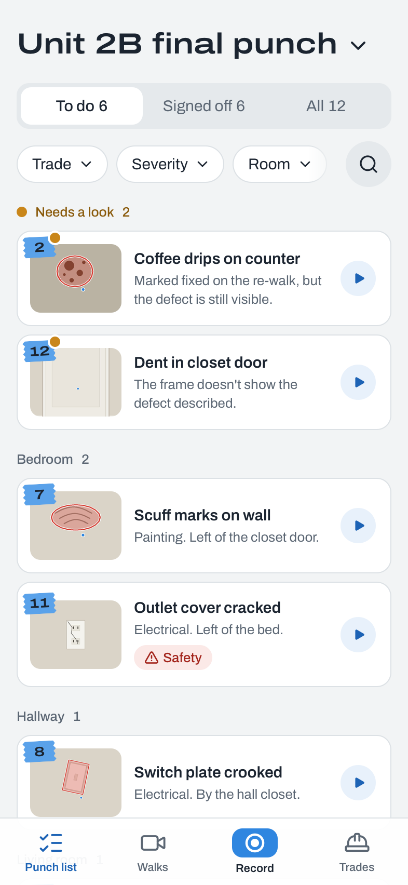
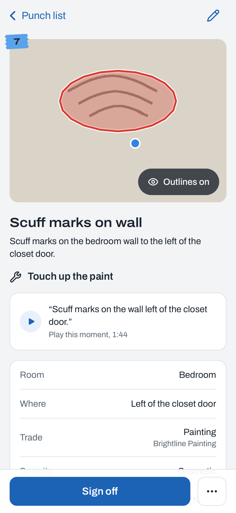
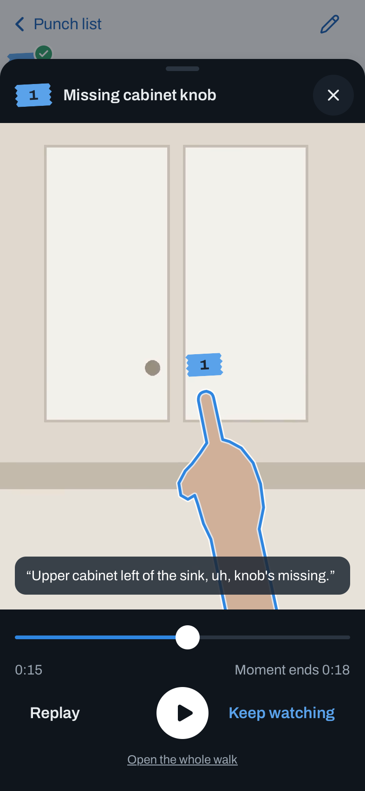
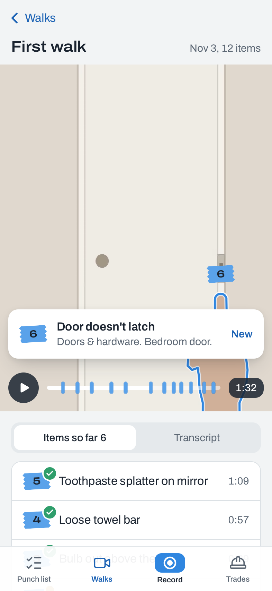
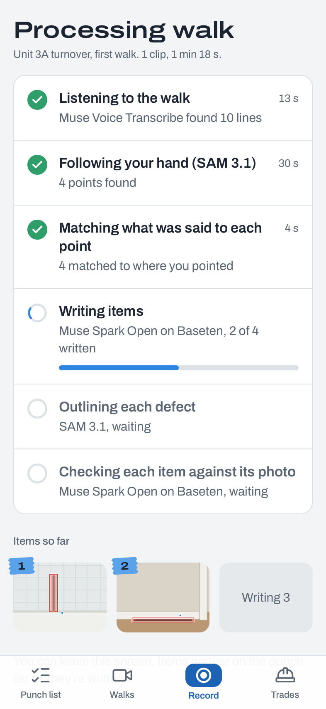
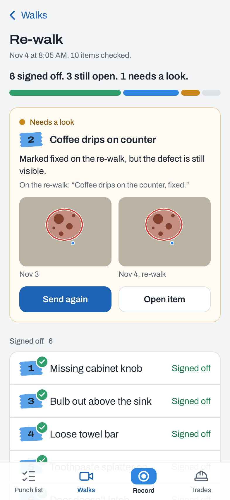
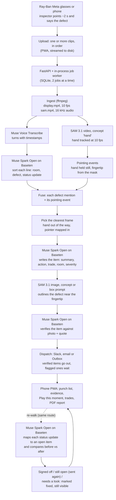

# Punchwalk

**Walk it once. Get a punch list with proof.** Punchwalk turns a construction punch walk into a verified,
dispatched punch list.

An inspector walks the unit wearing Ray-Ban Meta glasses (or holding a phone), points at each defect for
about two seconds, and says what's wrong. Punchwalk turns that one video into a punch list. Each item has
a photo showing exactly where the finger pointed and the defect outlined, plus a plain summary, the action
needed, the trade, the room and the severity. Every item is checked against its own photo and the
inspector's words, then sent to the trade that has to fix it. On the re-walk, Punchwalk signs off what's
fixed, with before and after photos, and flags anything "marked fixed, but the defect is still visible".

*The voice says what. SAM proves where. Spark Open writes it up and checks it.*

- **Live app:** https://punchwalk.fly.dev (deploying)
- **Demo video (3 min):** `<!-- VIDEO_URL -->` (coming soon)
- **Built for:** Meta Global AI Developer Hackathon, Startup track, Nov 3–4, 2026

| Punch list | Item detail | Play this moment | Walk detail | Processing | Re-walk summary |
|---|---|---|---|---|---|
|  |  |  |  |  |  |

<sub>iPhone 15 Pro (393 × 852), WebKit, from `make screenshots`. These are captured from the app's mock-data
build, so the photos are synthetic scenes drawn for the fixtures. `<!-- SCREENS_REAL -->` Real-walk captures
replace them after the labeled run. More screens are in `docs/screens/`: sending to a trade, how a walk was
processed, and the landing page.</sub>

## Why

A final punch walk takes minutes. The write-up takes hours: photos sorted by hand, defects retyped from
notes, a spreadsheet per trade. The contractor's final payment waits on it. Project managers do this on
their phones, between sites. Punchwalk makes the walk itself the input, and every item carries its proof:
the exact second of video, the photo with the defect outlined, and the inspector's own words.

## How it works



Every stage is idempotent, cached, timed and resumable, and every external call is logged as a
`ModelCall` row with latency and estimated cost. That log is what the "How this walk was processed"
screen shows.

### Each Meta model and exactly what it does

| Model | Where | What it does in Punchwalk |
|---|---|---|
| **Muse Voice Transcribe** (`muse-voice-transcribe-1.0`) | Meta Model API, `/v1/asr/transcribe` | Transcribes the walk's audio in `ENDPOINTING` mode: one turn per sentence, with start and end times. A built-in construction vocabulary ("strike plate", "escutcheon", "GWB", room names) plus the project's keywords bias recognition. The turn times decide which pointing event a sentence belongs to and where "Play this moment" starts. |
| **SAM 3.1**, video (`sam-3.1`) | Meta Model API, `/v1/responses`, streamed | Tracks the concept "hand" through the walk at 10 fps, one request per uploaded clip. A hand that holds still during a defect mention becomes a pointing event, and the fingertip comes from the hand mask. The walk view draws the hand outline from these masks. |
| **SAM 3.1**, image | same endpoint, image input | Outlines the defect on the evidence frame. First it tries a concept prompt with the noun phrase Spark Open chose (e.g. "door strike plate"), keeping the instance nearest the fingertip. If that fails, a box prompt from Spark Open's estimate. If both fail, the item keeps only the "pointed here" dot. |
| **Muse Spark Open** on Baseten (`meta-models/muse-spark-open-1026`) | Baseten, OpenAI-compatible chat completions, strict `json_schema` | All the reasoning. It sorts each transcript line (room, defect, status update) and writes each item from the evidence frame plus the quote (title, summary, action, trade, room, severity, what SAM should outline; `reasoning_effort=low`). It verifies each item against its rendered evidence and the original quote (`medium`). On a re-walk, it maps each status update to an open item and compares the before and after crops. |
| **Muse Spark 1.3** (`muse-spark-1.3`) | Meta Model API | **Fallback only.** It is used if Baseten fails twice (5xx or timeout) on a call. Every fallback is logged with `provider = "meta-fallback"` and shown in the UI. |

### Open weights

Every LLM call in the product path goes to **Muse Spark Open, Meta's open-weights model, served by
Baseten**, under the hackathon slug `meta-models/muse-spark-open-1026`. To be precise about what happened
on Nov 3: that slug returned `HTTP 404 {"error":"please check the model you provided"}`, while the catalog
slug `meta-models/muse-spark-open` answered. The client tries `-1026` first, falls back to the catalog slug
on a 404, remembers which slug answered, and records it on every call (`fixtures/probe/README.md`). Both
slugs are the same open-weights model on Baseten. The hosted Muse Spark 1.3 is reached only through the
logged fallback above, and `REASONING_PROVIDER=meta` is the explicit switch to use it instead.

### Pointing, not markers

The inspector doesn't stage anything. The hand is the marker: point with an index finger close to the
defect, hold about two seconds, describe it. SAM 3.1 follows the hand, and the fingertip locates the
defect. Defects that are described without pointing still become items (voice-only), with a photo picked
from the moment they were described.

## Evaluation

The inspector labels the staged defects for each walk (`eval/labels/*.csv`). `make eval` matches
predicted items to labels: within 6 s, and the same room or similar words, with a Hungarian assignment.
It writes `eval/report.md`, and it runs entirely from the cache. walk3 is a holdout in a different space
and is never used for tuning.

<!-- EVAL_TABLE -->
| Metric | Target | walk1 (first walk) | walk2 (re-walk) | walk3 (holdout) |
|---|---|---|---|---|
| Defects found (recall) | ≥ 0.90 | _pending_ | n/a | _pending_ |
| Precision | ≥ 0.90 | _pending_ | n/a | _pending_ |
| Right trade | ≥ 0.85 | _pending_ | n/a | _pending_ |
| Right room | ≥ 0.90 | _pending_ | n/a | _pending_ |
| Defect outlined (pointed items) | reported | _pending_ | n/a | _pending_ |
| Needs a look rate | reported | _pending_ | _pending_ | _pending_ |
| Closure accuracy (signed off vs. really fixed) | ≥ 0.90 | n/a | _pending_ | n/a |
| False "fixed" claims caught | 100% | n/a | _pending_ | n/a |

Numbers land here after the labeled run (`make eval`, see `eval/report.md`).
<!-- /EVAL_TABLE -->

## Cost and time per walk

Prices are from `punchwalk/clients/cost.py`:
- SAM 3.1 video: $0.20 per 1,000 frames
- SAM 3.1 images: $2.50 per 1,000
- Muse Voice Transcribe: $0.18 per hour
- Muse Spark Open on Baseten: $1.25 / $4.25 per million input / output tokens
- Muse Spark 1.3 fallback: estimated at $3 / $15

| | Value | Source |
|---|---|---|
| Hand tracking | about $0.20 per 100 s of walk (10 fps = 1,000 frames) | price table |
| Writing + checking one item | about $0.003 (Spark Open) plus one or two SAM image calls ($0.0025 each) | price table and probe token counts |
| Synthetic 21 s walk, 3 items | $0.043 for transcription + hand tracking, then about $0.04 per full item pass (write, outline, verify) | measured, `fixtures/pipeline/README.md` |
| Live latencies | Files 2.3 s, SAM video 7.0 s for 90 frames, SAM image 1.4–2.9 s, ASR 3.6 s for 5 s of audio, Spark Open 4.2 s per call | measured, `fixtures/probe/README.md` |
| Typical 2–3 min walk | **estimate:** about $0.5–1.0 and 2–4 minutes end to end | estimate until the real walks are measured `<!-- COST_REAL -->` |

All development spend is in `data/cost_ledger.jsonl`, capped at $25. Re-running a walk from the cache costs $0.

## Run it

Requirements: Python 3.11 with [uv](https://docs.astral.sh/uv/), Node 22 with pnpm, and ffmpeg. The PDF
report also needs WeasyPrint's Pango libraries, which the Docker image includes.

```bash
make setup          # uv sync + pnpm install
cp .env.example .env  # then fill in MODEL_API_KEY and BASETEN_API_KEY (optional: SLACK_WEBHOOK_URL, RESEND_API_KEY + EMAIL_FROM)
make dev            # API + job worker on :8000 (serves the built PWA)
pnpm -C web dev     # the PWA with hot reload on :5173 (VITE_DATA=live to use the API)
make test           # offline: readonly cache + fixtures, no network
make eval           # eval/report.md from the cache
make seed           # the demo project from recorded walks, at $0 (see below)
make screenshots    # every DESIGN.md screen on the iPhone 15 Pro profile -> .verify/screens/
make docker         # one image: node build -> python 3.11 + ffmpeg + WeasyPrint
make deploy         # fly deploy (first-time setup: docs/DEPLOY.md)
```

**Demo data.** `make seed` creates the "Unit 2B final punch" project. It has a fictional trades
directory with `@example.com` contacts; Ace Electric has a Slack channel on an example domain that is
never contacted. The seed replays the recorded walks through the real pipeline from the cache, in
readonly mode, at $0. `--walks synth_walk` uses the synthetic walk in `fixtures/pipeline/`. The Linux
image's ffmpeg extracts frames with different bytes than the recording Mac, so on Fly the seed isn't
re-run. Export a snapshot where the walks were recorded (`scripts/seed.py --export`) and import it in
the container (`--import`). The commands are in [docs/DEPLOY.md](docs/DEPLOY.md).

**Layout.**
- `punchwalk/clients/`: the only code that calls the Meta Model API or Baseten, with the cache and cost ledger
- `punchwalk/pipeline/`: the stages
- `punchwalk/api/`: FastAPI and the job worker
- `punchwalk/dispatch/`: Slack, email, Outbox
- `punchwalk/report/`: the PDF
- `web/`: the React PWA
- `eval/`: labels and scoring
- `fixtures/`: recorded responses for offline tests

## Limitations

- **Pointing needs the hand in view for about two seconds**, close to the defect without covering it. A
  hand that never holds still, or points off-frame, gives a voice-only item (still listed, without the
  pointed-here dot).
- **One concept per SAM request.** The hand is tracked as "hand", and each defect outline is a separate
  image request, so a walk with many defects makes many small SAM calls.
- **No word timestamps.** Muse Voice Transcribe returns turn-level times, so a sentence covering two
  defects is split by meaning, not by the exact second each word was said.
- **Uploads are limited to 10 minutes and 400 MB per walk** (the transcription limit). Longer walks go up as
  separate walks.
- **The hackathon Baseten slug** (`-1026`) returned 404 during the build; the app falls back to the catalog
  slug of the same model and logs which one answered.
- **Replays are byte-exact.** Cached answers are keyed on the exact media, prompts and frames. A different
  ffmpeg build re-extracts frames differently, which is why the deployed demo imports a snapshot.
- One process, two walks at a time, SQLite on a single volume: right for a pilot, not yet for a fleet.

## Roadmap

- **Live, hands-free capture through Meta's Wearables Device Access Toolkit.** The glasses stream straight
  in, items are confirmed by voice as you walk, and a trade looks at a defect and hears its item.
- **Procore / Fieldwire sync**: push items, photos and status both ways.
- **Spec citations**: Muse Spark 1.3's 1M-token context reads the project specs and cites the section each
  item violates.
- **Live captions** on the walk video as it plays.

## Built during the hackathon

**Built during the Meta Global AI Developer Hackathon, Nov 3–4, 2026. Everything in this repo was created during the event.**

All footage and assets are our own: the walks were recorded by the team, and the fixtures and mock media
are synthetic. The build was planned and coordinated by an orchestrator agent (Claude Fable 5.1), and the
code was written by worker agents (Claude Opus 5.5), with every subphase independently verified before it
was committed. See `PLAN.md`, `PROGRESS.md` and `DECISIONS.md`.

**Nov 3, 2026**
- Scaffold, model clients for Files, Muse Voice Transcribe, SAM 3.1, and Muse Spark Open with its logged fallback. Includes a content-addressed cache and a cost ledger.
- `make probe`: one live call per API to confirm request and response shapes ($0.05). SAM mask coordinate check (masks are box-local).
- Contracts: database models, API schemas, a TypeScript mirror and mock API fixtures, all enforced by a contract test.
- Ingest: ordered clips → portrait-safe display video, 10 fps SAM video, 16 kHz audio, with HDR → SDR.
- Pointing pipeline: transcription, SAM 3.1 hand tracking, pointing events from the fingertip, turn classification, fusion, evidence frames.
- Items: Spark Open writes each one, SAM 3.1 outlines the defect near the fingertip, Spark Open verifies it, and a resumable job runner ties the stages together.
- API: SQLite (WAL), range-capable media for iOS video seeking, upload with limits, progress (poll and SSE), the hand overlay, and guards.
- PWA: design system, punch list, item detail, Play this moment, walk detail with the hand overlay, the record flow with a live checklist, and "How this walk was processed".
- Dispatch to Slack, email or the Outbox, with an auto-send policy (verified items go out, flagged ones wait), and a PDF punch report.
- Docker image and Fly config, and `make seed` (zero-cost replay, plus a snapshot for the deployed image).

**Nov 4, 2026**
- `<!-- NOV4_FEATURES -->` Real-walk recording and eval tuning, re-walk loop on the real footage, landing page, deploy, demo video.

## License

`<!-- LICENSE -->` To be added before the repo goes public.
